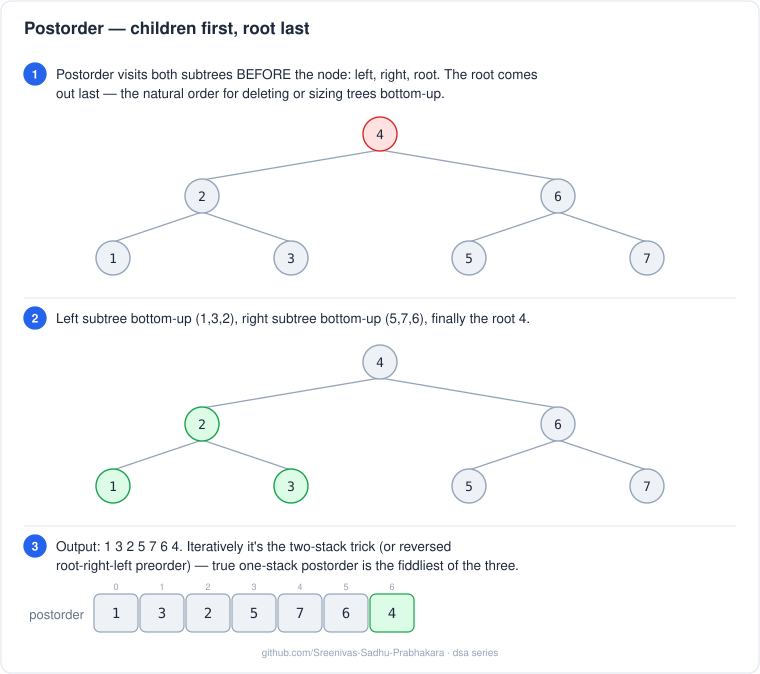

# Binary Tree Postorder Traversal

> Striver SDE Sheet 106 · Day 17 Binary Tree — run a mirrored preorder (root-right-left) and reverse it; the hard traversal becomes the easy one backwards. Go, stdlib only, tested.

## Problem

Visit left subtree → right subtree → root, iteratively. Postorder is the awkward one: a node is visited only after *both* subtrees, so a naive stack solution needs to remember whether it's returning from the left or the right child.

## Approach

Sidestep the bookkeeping with symmetry: root-right-left (a trivially easy preorder variant — just flip the push order) is exactly postorder *reversed*. Run it, reverse the output slice, done. The cost is holding the full output before reversing — fine when you're returning it anyway. The genuinely-streaming alternative (one stack plus a `lastVisited` pointer to detect "returning from the right") is the version to know for interviews that forbid the reversal; its complexity is identical, only the constant bookkeeping differs. Postorder's real-world role: it's deletion order and expression-evaluation order — children before parents.

**Complexity:** O(n) time, O(h) stack + output.

## Visual walkthrough

Read the picture top to bottom — each numbered frame is one moment of the algorithm
running on this repo's test example.

## Run

    go test ./...   # verify
    go run .        # demo

---

One of 191 repos solving Striver's SDE Sheet in Go — stdlib only, one problem per repo, every solution tested. Browse the set: [`dsa-*` repos](https://github.com/Sreenivas-Sadhu-Prabhakara?tab=repositories&q=dsa-&type=source).
